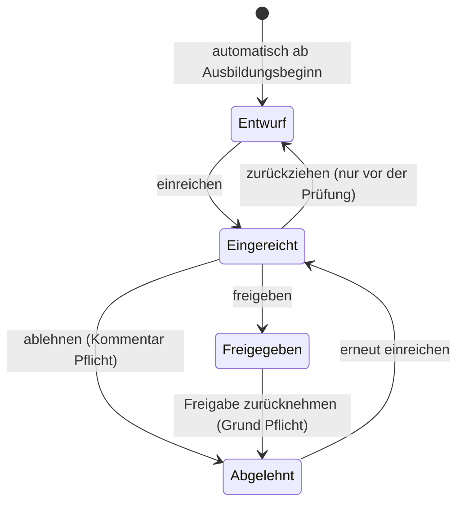

# Berichtsheft-App – Anforderungen und Akzeptanzkriterien

Stand: 06.10.2026 · freigegeben · Ergänzungen zu AK-201, AK-204, AK-206 bis AK-208 freigegeben am 06.10.2026 (Etappe 2) · Ergänzungen zu AK-203, AK-305, AK-306, AK-404, AK-406 bis AK-408 freigegeben am 06.10.2026 (Etappe 3) · Ergänzungen zu AK-501, AK-502, AK-505, AK-604 bis AK-606, AK-803 und zum Statusmodell freigegeben am 06.10.2026 (Etappe 4) · Ergänzungen zu AK-901 bis AK-907 und zum PDF-Export freigegeben am 06.10.2026 (Etappe 5) · Ergänzungen zu AK-1001 bis AK-1025 und zu Benachrichtigungen und Erinnerung freigegeben am 07.10.2026 (Etappe 6) · Ergänzungen zu AK-1101, AK-1102, zum Teams-Postfach und zum Beispielszenario „Erinnerung“ freigegeben am 07.10.2026 (Etappe 7) · Kapitel 12 „Kalender und Zeit“ (AK-1201 bis AK-1206) Entwurf zur Freigabe (Etappe G1, 12.10.2026)

Azubis führen ihr Berichtsheft digital als Wochenbericht, Ausbilder prüfen und geben es frei. Diese Spezifikation ist freigegeben und durch die Akzeptanzkriterien (AK) testbar. Technik und Hosting stehen in [02-plan.md](02-plan.md).

## Rollen, Anmeldung und Plattform

| Rolle | Aufgaben | Anzahl |
| --- | --- | --- |
| Azubi | Wochenberichte schreiben, einreichen, zurückziehen, überarbeiten | ca. 1–3 |
| Ausbilder (zugleich Admin) | Berichte prüfen, freigeben, ablehnen, Freigabe zurücknehmen; Personen und Rollen verwalten | ca. 1–3 |

- **Zuordnung:** Jeder Azubi hat genau einen fest zugeordneten Ausbilder, den der Admin festlegt. Nur dieser wird benachrichtigt; prüfen darf jeder Ausbilder (Vertretung).
- **Anmeldung:** ausschließlich über das Firmenkonto (z. B. Microsoft). Zugang haben nur Personen, die der Admin angelegt hat.
- **Plattform, erste Version:** Web-App, auf Smartphone-Breite voll bedienbar. Eigene Desktop- und Mobile-Apps sind spätere Ausbaustufen und nicht Teil dieser Kriterien.

## Wochenbericht

Ein Bericht umfasst eine Kalenderwoche mit den Tagen Mo–Fr; pro Azubi und Woche gibt es genau einen.

- **Entstehung:** Der Admin hinterlegt pro Azubi Ausbildungsbeginn und -ende. Ab Beginn existiert für jede Woche bis zur aktuellen automatisch ein Bericht im Status „Entwurf“. Manuelles Anlegen gibt es nicht.
- **Pro Tag:** eine Tagesart – Betrieb, Berufsschule, Urlaub, Krank oder Feiertag – und ein Freitext „Tätigkeiten“.
- **Feiertage** des vom Admin eingestellten Bundeslands sind als „Feiertag“ vorbelegt; der Azubi kann das ändern.
- **Tage außerhalb der Ausbildung** (vor Beginn, nach Ende in derselben Woche) sind ausgegraut und keine Pflicht.
- **Nicht enthalten:** Stunden, Abteilung, Lernfeld.
- **Entwurf speichern:** Ein Entwurf darf unvollständig gespeichert werden, auch ohne Tagesart; Pflicht wird sie erst beim Einreichen. „Tätigkeiten“ fasst bis zu 5.000 Zeichen pro Tag und wird unverändert gespeichert (Zeilenumbrüche einheitlich).
- **Geänderter Ausbildungszeitraum:** Fehlende Wochen werden ergänzt, in offenen Berichten aktiver Azubis wird „außerhalb der Ausbildung“ neu berechnet. Berichte werden nie automatisch gelöscht; eingetragene Inhalte bleiben, auch wenn der Tag nun außerhalb liegt. Wochen ganz außerhalb der Ausbildung zählen nicht als offen: Unberührte leere Entwürfe sind ausgeblendet, Wochen mit Inhalt oder Historie bleiben sichtbar und sind als „außerhalb der Ausbildung“ markiert. Wandert der Beginn zurück, erscheinen ausgeblendete Wochen wieder.

**Einreichen geht nur, wenn** alle Tage innerhalb der Ausbildung eine Tagesart haben und jeder Tag mit „Betrieb“ oder „Berufsschule“ einen nicht leeren Tätigkeitstext hat. Bei Urlaub, Krank und Feiertag ist kein Text nötig.

## Statusmodell



Zurückziehen geht nur, solange der Bericht noch nicht geprüft ist. Ablehnung und Rücknahme einer Freigabe führen beide nach „Abgelehnt“, und jeder Wechsel landet mit Person und Zeitpunkt in der Historie.

- **Prüfrunde:** Jede Einreichung beginnt eine neue Prüfrunde, auch die erneute Einreichung nach dem Zurückziehen. Ablehnung, Freigabe, Rücknahme und Kommentare gehören zur laufenden Runde; die Rücknahme also zur Runde der Freigabe, das erneute Einreichen danach öffnet die nächste.
- **Deaktivierter Azubi:** Einen eingereichten Bericht eines deaktivierten Azubis dürfen Ausbilder freigeben, aber nicht ablehnen; eine Freigabe lässt sich dann nicht zurücknehmen (sonst entstünde ein abgelehnter Bericht, den niemand überarbeiten kann). Der Bericht bleibt mit Hinweis „deaktiviert“ in der Prüfliste. Nach dem Wiederaktivieren gilt wieder alles.

## PDF-Export

- Einzelne Woche als PDF und Sammel-PDF für einen frei wählbaren Zeitraum (z. B. gesamte Ausbildung), jede Woche auf neuer Seite.
- Freigegebene Wochen tragen einen Freigabevermerk (Name des Ausbilders, Datum); nicht freigegebene sind deutlich als solche gekennzeichnet.
- **Inhalt:** nur der aktuelle Inhalt der Woche, Status und Vermerk bzw. Kennzeichnung; Kommentare, Verlauf und die Begründung einer Rücknahme kommen nicht ins PDF. Keine Unterschriftszeilen: Der elektronische Freigabevermerk gilt als Nachweis. Kein Hinweis „deaktiviert“ im PDF.
- **Zeitraum:** Zum Zeitraum gehört jede Woche, deren Mo–Fr ihn berührt (mindestens ein Arbeitstag zwischen Von und Bis); gedruckt wird immer die ganze Woche. Ausgeblendete Wochen (AK-306) fehlen. Vorbelegung: Ausbildungsbeginn bis heute, nach Ausbildungsende bis zum Ende. Ein Zeitraum ohne Wochen ergibt ein PDF mit Hinweis statt einer Fehlermeldung.
- **Seiten:** Kopfzeile mit Name, Kalenderwoche und Status bzw. „Nicht freigegeben“ auf jeder Seite; Fußzeile mit Erstellungsdatum und „Seite x von y“, gezählt über das ganze Dokument.

## Benachrichtigungen und Erinnerung

| Anlass | Empfänger |
| --- | --- |
| Bericht eingereicht | zugeordneter Ausbilder |
| Freigabe, Ablehnung, Rücknahme der Freigabe | Azubi |
| Vorwoche am Montag 9:00 Uhr noch offen | Azubi |
| Dieselbe Woche am folgenden Montag 9:00 Uhr immer noch offen | Azubi und zugeordneter Ausbilder, danach jeden Montag erneut bis zur Einreichung |

- **Kanäle:** Jede Person wählt selbst eine beliebige Kombination aus E-Mail, Teams und App, auch keinen. Voreinstellung für neue Personen: E-Mail + App. Wer alles abwählt, bekommt auch keine Erinnerungen.
- **Weitere Anlässe:** Erneutes Einreichen (nach Ablehnung oder Rücknahme) benachrichtigt den zugeordneten Ausbilder wie das erste Einreichen. Zurückziehen löst keine Benachrichtigung aus.
- **Inhalt:** Betreff mit Anlass, Azubi und Woche; der Text nennt Anlass, Azubi und Woche mit Zeitraum und verlinkt den Bericht. Kommentar- und Begründungstexte stehen nicht in der Nachricht, nur der Hinweis, dass sie im Bericht stehen. Nennt eine Nachricht mehrere Wochen, steht im Text jede Woche mit eigenem Link; der Link in der App führt dann zur Übersicht.
- **Rücksprung nach der Anmeldung:** Wer ohne Anmeldung eine geschützte Seite aufruft (z. B. über den Link einer Benachrichtigung), landet nach der Anmeldung direkt dort. Fremde Adressen als Ziel werden ignoriert.
- **„Überfällig“ für den Ausbilder:** eine Woche, die am Stichtag (Montag 9:00 Uhr) offen ist und vor der Vorwoche liegt, also schon am Montag davor offen war; das gilt auch für abgelehnte Wochen. Es zählt der Status am Stichtag. Der Ausbilder erhält eine Nachricht pro Azubi mit allen überfälligen Wochen dieses Azubis.
- **Ohne Kanal:** Ein Azubi ohne Kanal bekommt keine Erinnerung; sein Ausbilder wird trotzdem über seine eigenen Kanäle informiert.
- **Verpasster Montag:** Lief die Erinnerung um 9:00 Uhr nicht (z. B. Worker oder Rechner aus), wird sie einmal nachgeholt, sobald der Worker zwischen Montag 9:00 Uhr und Dienstag 23:59 Uhr derselben Woche läuft; Stichtag bleibt der Montag. Danach wird nicht mehr nachgeholt. Jede Woche läuft höchstens einmal.
- **Noch nicht versendete Nachrichten:** Geänderte Kanäle wirken erst ab dem nächsten Ereignis; bereits angelegte Nachrichten gehen über den ursprünglichen Kanal raus. An einen inzwischen deaktivierten Empfänger wird nichts mehr versendet.
- **Nicht zustellbare Nachrichten:** E-Mail- und Teams-Nachrichten, die nach mehreren Fehlversuchen aufgegeben werden oder deren Empfänger deaktiviert ist, sehen Ausbilder in der Liste „Nicht zustellbare Nachrichten“ mit Empfänger, Kanal, Anlass, Zeitpunkt des letzten Versuchs und Fehlermeldung, dazu einen Zähler im Menü. Mit „Erneut versuchen“ wird eine Nachricht an einen aktiven Empfänger noch einmal versendet. Azubis sehen die Liste nicht.
- **Teams in der Demo:** Bis zur Anbindung an Microsoft Teams landen Teams-Nachrichten im „Teams-Postfach (Demo)“ in der App; Azubis sehen dort ihre eigenen Nachrichten, Ausbilder alle. Eine produktive Installation bietet das Postfach nur an, wenn es ausdrücklich eingeschaltet ist (wie in der Demo); einen Test-Login ohne Firmenkonto gibt es im Produktionsbetrieb nie.

## Nutzerverwaltung

- Der Admin legt Personen an, ändert Rollen, ordnet Azubis einem Ausbilder zu und pflegt Ausbildungsbeginn und -ende sowie das Bundesland der Firma.
- **Entfernen deaktiviert:** keine Anmeldung mehr, Berichte bleiben lesbar und exportierbar.
- **Endgültiges Löschen** von Person und Berichten nur bewusst durch den Admin mit Bestätigung. Wer in der Historie von Berichten anderer Azubis vorkommt (Statuswechsel oder Kommentare), lässt sich nur deaktivieren, nicht endgültig löschen.
- **Anlegen über die Firmen-E-Mail:** Der Admin legt eine Person mit Firmen-E-Mail, Name und Rolle an. Beim ersten Login wird sie über die vom Firmenkonto bestätigte E-Mail zugeordnet; danach zählt nur noch das Firmenkonto selbst, eine spätere Änderung der E-Mail bricht die Zuordnung nicht.
- Der letzte aktive Ausbilder kann nicht entfernt oder herabgestuft werden; ein Ausbilder mit zugeordneten Azubis erst nach deren Neuzuordnung.
- **Wieder aktivieren:** Eine deaktivierte Person kann der Admin wieder aktivieren; ein Azubi nur, wenn sein zugeordneter Ausbilder aktiv ist.
- **Selbstschutz:** Ein Ausbilder kann sich nicht selbst deaktivieren oder löschen und nicht die eigene Rolle ändern; das übernimmt bei Bedarf ein anderer Ausbilder. Ist er der letzte aktive Ausbilder, erscheint die Meldung zu AK-207.

## Akzeptanzkriterien

Jedes Kriterium ist eine prüfbare Aussage mit eigener ID, damit Testfälle darauf verweisen können. „Offen“ heißt: Status „Entwurf“ oder „Abgelehnt“.

### 1. Anmeldung und Rollen

| ID | Kriterium |
| --- | --- |
| AK-101 | Anmeldung nur über das Firmenkonto; ein eigenes Passwort in der App gibt es nicht. |
| AK-102 | Ein Firmenkonto ohne Eintrag oder mit deaktivierter Person wird abgewiesen, mit dem Hinweis „Kein Zugang – bitte an den Ausbilder wenden“. |
| AK-103 | Ein Azubi sieht nur eigene Berichte; der direkte Aufruf eines fremden Berichts ergibt „Zugriff verweigert“. |
| AK-104 | Ein Azubi erreicht keine Prüf- oder Admin-Funktionen, auch nicht per direkt eingegebener URL. |
| AK-105 | Jeder Ausbilder kann die Berichte aller Azubis ansehen. |
| AK-106 | Nach dem Abmelden ist ohne erneute Anmeldung kein Zugriff möglich. |

### 2. Nutzerverwaltung (Admin)

| ID | Kriterium |
| --- | --- |
| AK-201 | Der Admin kann eine Person über ihr Firmenkonto anlegen und ihr die Rolle Azubi oder Ausbilder geben. Präzisierung: Angelegt wird mit Firmen-E-Mail, Name und Rolle; beim ersten Login wird die Person über die vom Identity Provider bestätigte E-Mail (ohne Groß-/Kleinschreibung) zugeordnet und die stabile Konto-ID gespeichert. Danach zählt nur noch die Konto-ID; eine spätere E-Mail-Änderung im Firmenkonto bricht die Zuordnung nicht. |
| AK-202 | Ein Azubi lässt sich nur mit zugeordnetem Ausbilder und Ausbildungsbeginn speichern; fehlt eines, nennt die Fehlermeldung das Feld. |
| AK-203 | Der Admin kann Rolle, zugeordneten Ausbilder sowie Ausbildungsbeginn und -ende ändern. Ergänzung: Ein geänderter Zeitraum ergänzt fehlende Wochen und berechnet in offenen Berichten „außerhalb der Ausbildung“ neu; gelöscht wird nichts. Ein Tag, der neu in die Ausbildung fällt, ohne Tagesart ist und ein Feiertag ist, wird nach dem aktuell eingestellten Bundesland als „Feiertag“ vorbelegt. Eingereichte und freigegebene Berichte sowie Berichte deaktivierter Azubis bleiben unverändert. Wochen ganz außerhalb der Ausbildung: siehe AK-306. |
| AK-204 | Entfernen deaktiviert die Person: keine Anmeldung mehr (AK-102); ihre Berichte bleiben für Ausbilder lesbar und exportierbar, sind aber nicht mehr änderbar. Ergänzung: Der Admin kann eine deaktivierte Person wieder aktivieren; einen Azubi nur, wenn sein zugeordneter Ausbilder aktiv ist. |
| AK-205 | Deaktivierte Azubis erhalten keine Erinnerungen, und für sie entstehen keine neuen Wochenberichte. |
| AK-206 | Endgültiges Löschen entfernt Person und alle Berichte, nur nach ausdrücklicher Bestätigung (z. B. Namen eintippen); danach ist kein Bericht mehr auffindbar. Ergänzung: Kommt die Person in der Historie von Berichten anderer Azubis vor (Statuswechsel oder Kommentare), lässt sie sich nur deaktivieren; die Oberfläche erklärt das und bietet „Deaktivieren“ an. |
| AK-207 | Der letzte aktive Ausbilder kann weder deaktiviert, gelöscht noch zum Azubi herabgestuft werden. Ergänzung: Kein Ausbilder kann sich selbst deaktivieren, löschen oder die eigene Rolle ändern; trifft beides zu, erscheint die Meldung zu AK-207. |
| AK-208 | Ein Ausbilder mit zugeordneten Azubis kann erst deaktiviert werden, wenn diese einem anderen Ausbilder zugeordnet sind. Präzisierung: Fürs Deaktivieren zählen nur aktive zugeordnete Azubis; fürs endgültige Löschen und fürs Herabstufen zum Azubi zählen alle, auch deaktivierte. |
| AK-209 | Der Admin kann das Bundesland der Firma für die Feiertage einstellen. |

### 3. Entstehung der Wochenberichte

| ID | Kriterium |
| --- | --- |
| AK-301 | Für jede Woche vom Ausbildungsbeginn bis zur aktuellen Woche existiert automatisch genau ein Bericht im Status „Entwurf“. Beispiel: Beginn 01.09.2026 (KW 36), heute 06.10.2026 (KW 41) → Berichte KW 36–41. |
| AK-302 | Für zukünftige Wochen gibt es keine Berichte; mit Beginn einer neuen Woche erscheint ihr Bericht automatisch. |
| AK-303 | Nach dem Ausbildungsende entstehen keine Berichte mehr. |
| AK-304 | Manuelles oder doppeltes Anlegen ist nicht möglich; pro Azubi und Woche gibt es immer genau einen Bericht. |
| AK-305 | Liegen Beginn oder Ende mitten in einer Woche, sind die Tage außerhalb der Ausbildung ausgegraut und brauchen weder Tagesart noch Text. Ergänzung: Diese Tage sind auch nicht änderbar. |
| AK-306 | Die Übersicht des Azubis zeigt alle Wochen mit Status; offene Wochen in der Vergangenheit sind deutlich hervorgehoben. Ergänzung: Ausbilder sehen pro Azubi dieselbe Liste, nur lesend. Wochen ganz außerhalb der Ausbildung (nach Verschiebung von Beginn oder Ende) zählen nie als offen, auch nicht für die Erinnerung; unberührte leere Entwürfe davon sind ausgeblendet, Wochen mit Inhalt oder Historie als „außerhalb der Ausbildung“ markiert. |

### 4. Bericht erfassen

| ID | Kriterium |
| --- | --- |
| AK-401 | Jeder Bericht zeigt Mo–Fr mit Datum, pro Tag eine Auswahl der Tagesart und ein Freitextfeld „Tätigkeiten“. |
| AK-402 | Zur Auswahl stehen genau: Betrieb, Berufsschule, Urlaub, Krank, Feiertag. |
| AK-403 | Felder für Stunden, Abteilung oder Lernfeld gibt es nicht. |
| AK-404 | Gesetzliche Feiertage des eingestellten Bundeslands sind als „Feiertag“ vorbelegt. Beispiele: Fr 25.12.2026 ist vorbelegt; Do 27.05.2027 (Fronleichnam) bei Nordrhein-Westfalen ja, bei Niedersachsen nein. Ergänzung: vorbelegt wird beim Anlegen des Berichts und nur an Tagen innerhalb der Ausbildung; eine spätere Änderung des Bundeslands ändert bestehende Berichte nicht. |
| AK-405 | Der Azubi kann eine vorbelegte Tagesart ändern, z. B. von „Feiertag“ auf „Berufsschule“. |
| AK-406 | Ein Entwurf lässt sich speichern und später weiterbearbeiten; nach Ab- und erneuter Anmeldung ist der Inhalt unverändert. Ergänzung: Gespeichert wird ausdrücklich per „Speichern“; ein Entwurf darf dabei unvollständig sein. |
| AK-407 | Umlaute, Zeilenumbrüche und lange Texte (mindestens 2.000 Zeichen pro Tag) werden unverändert gespeichert und angezeigt. Präzisierung: Obergrenze 5.000 Zeichen pro Tag (Unicode-Zeichen, ein Zeilenumbruch zählt als eins), bei Überschreitung Meldung am Feld; Zeilenumbrüche werden einheitlich gespeichert, sonst bleibt der Text exakt. |
| AK-408 | Wer die Seite mit ungespeicherten Änderungen verlässt, wird gewarnt, oder die Änderungen werden automatisch gespeichert. Präzisierung: gewarnt wird bei Links und Formularen der App (z. B. „Abmelden“), beim Schließen und Neuladen sowie bei Zurück und Vor im Browser. |

### 5. Einreichen und Zurückziehen

| ID | Kriterium |
| --- | --- |
| AK-501 | Ein offener Bericht lässt sich nur einreichen, wenn alle Tage innerhalb der Ausbildung eine Tagesart haben und jeder Tag mit „Betrieb“ oder „Berufsschule“ einen nicht leeren Text hat (nur Leerzeichen gelten als leer). Ergänzung: Wochen ganz außerhalb der Ausbildung lassen sich nicht einreichen, auch mit Inhalt. Die laufende Woche darf schon vor ihrem Ende eingereicht werden, sobald die Pflichtangaben vollständig sind. |
| AK-502 | Ist eine Bedingung aus AK-501 nicht erfüllt, wird nicht eingereicht; die betroffenen Tage werden benannt und markiert. Ergänzung: Markiert wird am Tag mit „Tagesart fehlt“ bzw. „Tätigkeiten fehlen“. |
| AK-503 | Bei Urlaub, Krank und Feiertag ist kein Text nötig; ein trotzdem eingetragener Text wird gespeichert und angezeigt. |
| AK-504 | Auch eine Woche nur aus Urlaub und Feiertagen muss eingereicht werden und zählt bis dahin als offen. |
| AK-505 | Nach dem Einreichen ist der Status „Eingereicht“ und der Bericht für den Azubi schreibgeschützt. Ergänzung: Einreichen speichert ungespeicherte Änderungen mit; scheitert die Prüfung auf dem Server, bleiben sie als Entwurf gespeichert. Eingereichte und freigegebene Berichte schützt zusätzlich die Datenbank vor Änderungen. |
| AK-506 | Der Azubi kann einen eingereichten Bericht zurückziehen: Status wieder „Entwurf“, bearbeitbar, nicht mehr in der Prüfliste. |
| AK-507 | Ein bereits freigegebener oder abgelehnter Bericht kann nicht zurückgezogen werden; die Schaltfläche fehlt oder ist gesperrt. |
| AK-508 | Zieht der Azubi zurück, während ein Ausbilder den Bericht offen hat, scheitert dessen Freigabe oder Ablehnung mit „Bericht wurde zurückgezogen“. Umgekehrt scheitert das Zurückziehen mit Meldung, wenn schon geprüft wurde. |

### 6. Prüfen (Ausbilder)

| ID | Kriterium |
| --- | --- |
| AK-601 | Die Prüfliste zeigt eingereichte Berichte mit Azubi, Woche und Einreichungsdatum; standardmäßig die der eigenen Azubis, per Filter alle. |
| AK-602 | Jeder Ausbilder darf jeden eingereichten Bericht freigeben oder ablehnen, auch ohne Zuordnung (Vertretung). |
| AK-603 | Bei der Freigabe wird der Status „Freigegeben“; Name des Ausbilders sowie Datum und Uhrzeit werden gespeichert. |
| AK-604 | Ablehnen geht nur mit einem nicht leeren Gesamtkommentar. Ergänzung: Gesamtkommentar, Tageskommentare und Begründung einer Rücknahme fassen je bis zu 5.000 Zeichen. |
| AK-605 | Zu jedem Tag kann der Ausbilder zusätzlich einen eigenen, optionalen Kommentar schreiben. Ergänzung: Tageskommentare sind an jedem Tag möglich, auch außerhalb der Ausbildung. Beim Freigeben werden eingetippte Kommentare nicht gespeichert; der Bestätigungsdialog weist darauf hin. |
| AK-606 | Nach einer Ablehnung ist der Status „Abgelehnt“; der Azubi sieht den Gesamtkommentar und jeden Tageskommentar beim jeweiligen Tag. Ergänzung: Nach einer Rücknahme (AK-703) sieht der Azubi oben die Begründung. Nach dem erneuten Einreichen stehen die Kommentare nur noch in der Historie, nicht mehr beim Tag. |
| AK-607 | Berichte im Status „Entwurf“ kann der Ausbilder weder freigeben noch ablehnen. |

### 7. Überarbeiten und Freigabe zurücknehmen

| ID | Kriterium |
| --- | --- |
| AK-701 | Ein abgelehnter Bericht ist für den Azubi bearbeitbar und erneut einreichbar; danach ist er „Eingereicht“ und wieder in der Prüfliste. |
| AK-702 | Der Zyklus aus Ablehnen und erneutem Einreichen funktioniert beliebig oft. Testfall: dreimal ablehnen, dann freigeben. |
| AK-703 | Ein Ausbilder kann eine Freigabe nur mit nicht leerer Begründung zurücknehmen; danach ist der Status „Abgelehnt“ und der Bericht bearbeitbar. |
| AK-704 | Außer durch die Rücknahme (AK-703) kann niemand einen freigegebenen Bericht ändern, auch kein Ausbilder. |

### 8. Historie

| ID | Kriterium |
| --- | --- |
| AK-801 | Jeder Bericht hat eine Historie aller Statuswechsel (Einreichen, Zurückziehen, Freigabe, Ablehnung, Rücknahme) mit Datum, Uhrzeit, Person und neuem Status. |
| AK-802 | Kommentare und Begründungen früherer Runden bleiben erhalten und sind ihrer Runde zugeordnet. |
| AK-803 | Historieneinträge kann niemand bearbeiten oder löschen; nur das endgültige Löschen der Person (AK-206) entfernt sie. Ergänzung: Das gilt für Statuswechsel und Kommentare; die Datenbank weist ihr Ändern und Löschen ab. |

### 9. PDF-Export

| ID | Kriterium |
| --- | --- |
| AK-901 | Eine Woche lässt sich als PDF exportieren, mit Name des Azubis, Kalenderwoche, Zeitraum, allen Tagen mit Datum, Tagesart und Tätigkeiten sowie dem Status. Ergänzung: Exportiert wird der zuletzt gespeicherte Stand. Hat der Editor ungespeicherte Änderungen, erscheint vor dem Download der Hinweis „Es wird der zuletzt gespeicherte Stand exportiert.“ (bestätigen → Download, abbrechen → bleibt im Editor); ohne ungespeicherte Änderungen kein Hinweis. |
| AK-902 | Für einen Zeitraum (von–bis) entsteht ein Sammel-PDF aller Wochen in zeitlicher Reihenfolge; jede Woche beginnt auf einer neuen Seite. Ergänzung: Welche Wochen dazugehören, regelt der Abschnitt „PDF-Export“. |
| AK-903 | Freigegebene Wochen tragen einen Freigabevermerk mit Name des Ausbilders und Datum. Präzisierung: Datum und Uhrzeit der aktuell gültigen Freigabe, z. B. „Freigegeben von Bernd Ausbilder am 05.10.2026, 09:45 Uhr“. |
| AK-904 | Nicht freigegebene Wochen sind deutlich gekennzeichnet, z. B. „Nicht freigegeben – Status: Entwurf“. |
| AK-905 | Nach einer Rücknahme (AK-703) enthält ein neu erzeugtes PDF keinen Freigabevermerk mehr. |
| AK-906 | Der Azubi exportiert nur eigene Berichte, ein Ausbilder die aller Azubis, auch deaktivierter. Ergänzung: Fremde Berichte ergeben „Zugriff verweigert“ (HTTP 403), unbekannte „Seite nicht gefunden“ (HTTP 404). |
| AK-907 | Umlaute und lange Texte erscheinen im PDF vollständig, nichts wird abgeschnitten. Ergänzung: Keine automatische Silbentrennung; nur Wörter ohne Leerzeichen mit mehr als 24 Zeichen werden mit Trennstrich am Zeilenende umbrochen. |

### 10. Benachrichtigungen

| ID | Kriterium |
| --- | --- |
| AK-1001 | Beim Einreichen wird der zugeordnete Ausbilder benachrichtigt, andere Ausbilder nicht. |
| AK-1002 | Bei Freigabe, Ablehnung und Rücknahme einer Freigabe wird der Azubi benachrichtigt. Ergänzung: Erneutes Einreichen benachrichtigt den zugeordneten Ausbilder wie das erste Einreichen; Zurückziehen benachrichtigt niemanden. |
| AK-1003 | Jede Benachrichtigung nennt Azubi, Woche und Anlass und verlinkt den Bericht; der Link führt nach der Anmeldung direkt dorthin. Ergänzung: Kommentar- und Begründungstexte stehen nicht in der Nachricht. Bei mehreren Wochen steht im Text jede Woche mit eigenem Link, der Link in der App führt zur Übersicht. Der Rücksprung nach der Anmeldung gilt für jede geschützte Seite; fremde Adressen werden ignoriert. |
| AK-1004 | Pro Ereignis und Kanal geht genau eine Nachricht raus, ohne Duplikate. Ergänzung: Scheitert der Versand, wird er mit Wartezeit wiederholt; nach mehreren Fehlversuchen oder bei deaktiviertem Empfänger wird aufgegeben, und die Nachricht erscheint für Ausbilder unter „Nicht zustellbare Nachrichten“ (mit „Erneut versuchen“). |
| AK-1011 | Jede Person kann E-Mail, Teams und App beliebig kombinieren, auch alle abwählen. |
| AK-1012 | Neue Personen haben die Voreinstellung E-Mail + App. |
| AK-1013 | Benachrichtigt wird nur über die gewählten Kanäle; ohne Kanal geht keine Nachricht raus, der Status bleibt in der App sichtbar. |
| AK-1014 | Geänderte Kanal-Einstellungen gelten ab dem nächsten Ereignis. Ergänzung: Bereits angelegte, noch nicht versendete Nachrichten gehen über den ursprünglichen Kanal raus. |
| AK-1015 | Der Kanal „App“ zeigt ungelesene Benachrichtigungen mit Zähler; nach dem Öffnen gelten sie als gelesen. Präzisierung: Das Öffnen der Liste der Benachrichtigungen markiert alle als gelesen; die bis dahin ungelesenen sind dabei noch als „Neu“ hervorgehoben. |
| AK-1021 | Ist die Vorwoche am Montag um 9:00 Uhr noch offen, erhält der Azubi eine Erinnerung. Ergänzung: Lief der Job um 9:00 Uhr nicht, wird er einmal nachgeholt, sobald der Worker bis Dienstag 23:59 Uhr derselben Woche läuft; Stichtag bleibt der Montag. |
| AK-1022 | Ist dieselbe Woche am folgenden Montag um 9:00 Uhr noch offen, wird zusätzlich der zugeordnete Ausbilder informiert. Präzisierung: Das gilt für jede Woche, die am Stichtag offen ist und vor der Vorwoche liegt, auch abgelehnte; eine Nachricht pro Azubi. Ein Azubi ohne Kanal bekommt keine Erinnerung, der Ausbilder wird trotzdem informiert. |
| AK-1023 | Für eingereichte oder freigegebene Wochen und für die laufende Woche kommt keine Erinnerung. |
| AK-1024 | Danach gehen Erinnerung und Information jeden Montag erneut raus, bis die Woche eingereicht ist. |
| AK-1025 | Sind mehrere Wochen offen, nennt die Erinnerung alle offenen Wochen in einer Nachricht. |

### 11. Plattform und Qualität

| ID | Kriterium |
| --- | --- |
| AK-1101 | Die Web-App funktioniert in den aktuellen Versionen von Edge, Chrome und Firefox. Ergänzung: Nachgewiesen, indem alle Browser-Tests in allen drei Browsern laufen. |
| AK-1102 | Bei 375 px Breite sind alle Kernfunktionen ohne horizontales Scrollen bedienbar: erfassen, einreichen, zurückziehen, prüfen, kommentieren, exportieren, Einstellungen. Ergänzung: Das gilt auch für die übrigen Seiten (Übersicht, Prüfliste, Nutzerverwaltung, Benachrichtigungen, Nicht zustellbar, Anmelden, Kein Zugang). |

### 12. Kalender und Zeit

Entwurf zur Freigabe (Etappe G1, 12.10.2026). Eigentümer ist das Modul M01 (`specs/M01-kalender-und-zeit.md`); AK-404 gehört ebenfalls zu M01.

| ID | Kriterium |
| --- | --- |
| AK-1201 | Fachliche Regeln beziehen „jetzt“ aus einer zentralen Uhr. Für Tests und Vorführungen ist sie auf einen festen Zeitpunkt stellbar, im Produktivbetrieb nicht. Ergänzung: Im Produktivbetrieb wirkt eine Vorgabe des Zeitpunkts aus der Konfiguration nicht; es gilt die Systemzeit. |
| AK-1202 | Maßgeblich ist der Kalendertag in Europe/Berlin, mit Sommer- und Winterzeit. Beispiel: 05.10.2026, 22:30 UTC ist Dienstag, 06.10.2026. Ergänzung: Eine neue Woche beginnt Montag, 0:00 Uhr Berliner Zeit; Sonntag 23:59 Uhr gehört noch zur alten Woche. |
| AK-1203 | Wochen sind ISO-8601-Kalenderwochen von Montag bis Sonntag (Woche 1 enthält den 4. Januar). Beispiele: 01.01.2027 liegt in KW 53/2026, 29.12.2025 in KW 1/2026. |
| AK-1204 | Eine Woche, die es nicht gibt, wird abgewiesen, z. B. KW 53/2027 oder KW 0. Ergänzung: Sie wird nie still in eine Woche des Nachbarjahrs umgedeutet. |
| AK-1205 | Wählbar sind genau die 16 Bundesländer mit festen Kürzeln (BW, BY, BE, BB, HB, HH, HE, MV, NI, NW, RP, SL, SN, ST, SH, TH); ein unbekanntes Kürzel wird abgewiesen. |
| AK-1206 | Feiertag ist jeder landesweite gesetzliche Feiertag des Bundeslands, einschließlich einmaliger landesweiter Feiertage (z. B. 08.05.2025 in Berlin); nur kommunale oder regionale Feiertage zählen nicht. Ergänzung: Maßgeblich ist das Feiertagsrecht des jeweiligen Jahres, z. B. Reformationstag in Niedersachsen erst ab 2018 (2017 einmalig bundesweit). |

## Beispielszenarien

Die drei Szenarien decken die Kernabläufe ab und lassen sich direkt als Testfälle übernehmen.

```gherkin
Szenario: Erinnerung und Information an den Ausbilder
  Angenommen Azubi "Anna" ist "Bernd" zugeordnet
  Und Annas Bericht KW 41 (05.–09.10.2026) hat den Status "Entwurf"
  Wenn es Montag, 12.10.2026, 9:00 Uhr ist
  Dann erhält Anna eine Erinnerung für KW 41
  Und Bernd erhält keine Nachricht
  Wenn der Bericht am Montag, 19.10.2026, 9:00 Uhr immer noch offen ist
  Dann erhält Anna erneut eine Erinnerung
  Und Bernd wird über die offene KW 41 informiert
```

Präzisierung (Etappe 7): Annas Wochen vor KW 41 (KW 36–40) sind eingereicht oder freigegeben. Sonst wären sie am 12.10.2026 bereits überfällig, und Bernd würde schon dann informiert.

```gherkin
Szenario: Einreichen scheitert an fehlendem Text
  Angenommen Annas Bericht KW 52/2026 hat Mo–Do "Betrieb" mit Text
  Und Freitag 25.12.2026 ist automatisch als "Feiertag" vorbelegt
  Wenn Anna Freitag auf "Berufsschule" ändert und einreicht
  Dann wird der Bericht nicht eingereicht
  Und Freitag ist als "Tätigkeiten fehlen" markiert
```

```gherkin
Szenario: Vertretung nimmt Freigabe zurück
  Angenommen Annas Bericht KW 40 wurde von "Bernd" freigegeben
  Wenn Ausbilderin "Clara" (nicht zugeordnet) die Freigabe mit Begründung "Mittwoch falsches Datum" zurücknimmt
  Dann hat der Bericht den Status "Abgelehnt"
  Und Anna erhält eine Benachrichtigung über ihre gewählten Kanäle
  Und die Historie zeigt Bernds Freigabe und Claras Rücknahme mit Begründung
  Und ein neu erzeugtes PDF enthält keinen Freigabevermerk
```

## Begriffe und bestätigte Annahmen

| Begriff | Bedeutung |
| --- | --- |
| Offen | Status „Entwurf“ oder „Abgelehnt“; zählt für die Erinnerung als nicht eingereicht |
| Zugeordneter Ausbilder | der Ausbilder, den der Admin dem Azubi fest zugewiesen hat |
| Vertretung | jeder andere Ausbilder; darf prüfen, wird aber nicht benachrichtigt |
| Noch nie angemeldet | Person ist angelegt, ihr Firmenkonto aber noch nicht verknüpft (keine Konto-ID gespeichert); das ändert sich mit dem ersten Login |
| Kanal | Weg einer Benachrichtigung: E-Mail, Teams oder App |

Bestätigt wurden außerdem: Zuordnung und Bundesland legt nur der Admin fest (AK-202, AK-209); ein Ausbilder mit Azubis wird erst nach Neuzuordnung deaktiviert (AK-208); Tage außerhalb der Ausbildung sind keine Pflicht (AK-305); die wöchentliche Erinnerung läuft bis zur Einreichung weiter (AK-1024); wer alle Kanäle abwählt, bekommt keine Erinnerungen (AK-1013).
