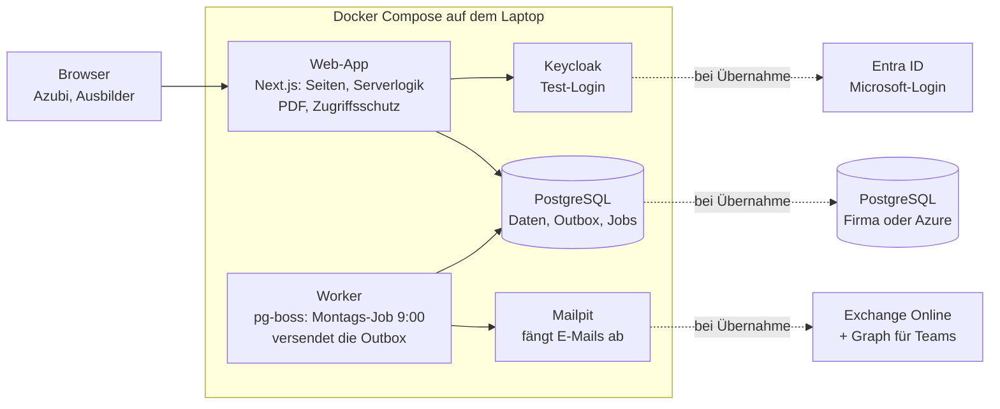

# Plan: Technik und Hosting

Stand: 06.10.2026 · freigegeben · Entscheidungen aus Etappe 1 und 2 ergänzt (freigegeben am 06.10.2026)

Die erste Version läuft als Demo per Docker Compose auf dem eigenen Rechner: eine TypeScript-Web-App mit PostgreSQL, Test-Login und Test-Mailserver. Für die Übernahme in die Firmeninfrastruktur werden nur Konfiguration und Zielumgebung getauscht, nicht der Code. Anforderungen und Akzeptanzkriterien: [01-spezifikation.md](01-spezifikation.md).

## Entscheidungen

Alles läuft in einem TypeScript-Stack, und jeder externe Dienst steckt hinter einer Schnittstelle, die später per Konfiguration getauscht wird.

| Baustein | Demo auf dem Laptop | Warum | Bei Übernahme |
| --- | --- | --- | --- |
| Sprache | TypeScript | ein Stack für Oberfläche und Server, gut mit Claude wartbar | bleibt |
| Web-Framework | Next.js (App Router) mit React | Seiten und Server-Logik in einer App; keine getrennte API nötig für 2–6 Nutzer | bleibt |
| Oberfläche | Tailwind CSS, mobil zuerst gestaltet | Bedienbarkeit bei 375 px (AK-1102) | bleibt |
| Datenbank | PostgreSQL im Container | Transaktionen für Statusübergänge, überall verfügbar | Firmen-PostgreSQL oder Azure Database for PostgreSQL |
| Datenzugriff | Prisma (Schema + Migrationen) | typsicher, Datenmodell versioniert im Repository | bleibt |
| Anmeldung | Auth.js mit OpenID Connect; Keycloak-Container mit Testkonten | gleiches Protokoll wie Microsoft, echter Login-Ablauf schon in der Demo | Microsoft Entra ID (App-Registrierung) |
| Zuordnung beim Login | Admin legt Person mit Firmen-E-Mail an; der erste Login ordnet sie über die bestätigte E-Mail zu (Keycloak: Claim `email_verified`) und speichert die Konto-ID (`sub`); danach zählt nur die Konto-ID | kein Abtippen von Konto-IDs; spätere E-Mail-Änderungen brechen die Zuordnung nicht | Entra ID: Konto-ID `oid`, Bestätigung über einen konfigurierbaren Claim (z. B. optionales Claim `xms_edov`) |
| Sitzungen | signierte JWT-Cookies, 8 Stunden gültig, kein serverseitiger Widerruf | einfach, keine Sitzungstabelle; eine Deaktivierung wirkt trotzdem sofort, weil jede Anfrage die Person in der Datenbank prüft | bleibt |
| Rollen und Zuordnung | in der App-Datenbank | der Admin pflegt sie in der App, nicht im Firmenkonto | bleibt |
| Zeitgesteuerte Jobs | pg-boss in einem eigenen Worker-Container | Erinnerung Mo 9:00 Uhr (Europe/Berlin), Jobs ohne Duplikate | bleibt |
| E-Mail | SMTP über Nodemailer an Mailpit | fängt alle Mails ab, Ansicht im Browser, nichts geht nach außen | Exchange Online |
| Teams | simuliert: Nachrichten landen in einem Entwickler-Postfach | echte Teams-Nachrichten brauchen den Firmen-Tenant | Microsoft Graph, mit der IT zu klären |
| App-Benachrichtigung | eigene Tabelle, Glocke mit Zähler | AK-1015 | bleibt |
| Feiertage | npm-Paket feiertagejs | alle Bundesländer, ohne Internetzugriff | bleibt |
| PDF | @react-pdf/renderer mit eingebetteter Schrift | kein Browser im Container nötig, Umlaute sicher (AK-907) | bleibt |
| Tests | Vitest (Logik), Playwright (Browser) | jedes AK als benannter Test | bleibt |
| Code und CI | GitHub-Repository, GitHub Actions | Prüfung bei jedem Push | bleibt |
| Betrieb | Docker Compose, ein Befehl startet alles | identische Container später auf Server oder Cloud | Docker Compose auf Firmen-VM oder Azure Container Apps |

## Architektur

App und Worker sprechen nur über die Datenbank miteinander: Die App schreibt Benachrichtigungen in die Outbox, der Worker versendet sie und führt den Montags-Job aus. Teams-Nachrichten landen in der Demo in einem Entwickler-Postfach innerhalb der App.

## Umsetzung der Kernanforderungen

Die fachlichen Regeln liegen in wenigen serverseitigen Modulen ohne Abhängigkeit zur Oberfläche. So lassen sie sich mit Vitest direkt gegen die Akzeptanzkriterien prüfen.

### Datenmodell

| Tabelle | Inhalt | Wichtige Regel |
| --- | --- | --- |
| Person | Firmenkonto-ID, E-Mail, Name, Rolle, aktiv, zugeordneter Ausbilder, Ausbildungsbeginn und -ende, gewählte Kanäle | Azubi nur mit Ausbilder und Beginn speicherbar (AK-202); Firmenkonto-ID leer bis zum ersten Login, danach eindeutig und fest; E-Mail eindeutig, klein geschrieben gespeichert |
| Einstellung | Bundesland der Firma | eine Zeile für die ganze App |
| Wochenbericht | Azubi, ISO-Jahr, ISO-Woche, Status, Versionszähler | eindeutig pro Azubi und Woche (AK-304) |
| Tag | Bericht, Datum, Tagesart, Tätigkeiten, außerhalb der Ausbildung ja/nein | Tagesart nur aus den fünf Werten (AK-402) |
| Kommentar | Bericht, Prüfrunde, Tag (leer = Gesamtkommentar), Person, Text, Zeitpunkt | nie änderbar |
| Statuswechsel | Bericht, alter und neuer Status, Person, Zeitpunkt, Begründung | nie änderbar; die Datenbank weist UPDATE und DELETE ab (AK-803) |
| Benachrichtigung | Ereignis, Empfänger, Kanal, Inhalt, gesendet am, gelesen am | eindeutig pro Ereignis und Kanal (AK-1004) |

### Regeln und Abläufe

- **Statusübergänge:** Eine einzige Funktion prüft jeden Wechsel gegen die erlaubten Übergänge des Statusmodells. Sie schreibt ihn als bedingtes Update („nur wenn Status und Version noch stimmen“). Trifft das nicht mehr zu, scheitert die Aktion mit Meldung; das deckt das gleichzeitige Zurückziehen und Prüfen ab (AK-508).
- **Wochenberichte erzeugen:** Fehlende Wochen vom Ausbildungsbeginn bis zur aktuellen Woche werden beim Öffnen der Übersicht und zusätzlich täglich per Job angelegt. Tage außerhalb der Ausbildung werden markiert, Feiertage des Bundeslands per feiertagejs vorbelegt.
- **Einreichen prüfen:** Die Pflichtfeld-Regel aus AK-501 ist eine Funktion, die Oberfläche und Server gemeinsam nutzen. Der Server prüft immer, die Oberfläche nur zur Vorschau.
- **Zugriffsschutz:** Jede Serveraktion prüft Rolle und Besitz selbst; ausgeblendete Schaltflächen allein gelten nicht als Schutz (AK-103, AK-104).
- **Anmeldung und Zuordnung:** Beim Login sucht die App zuerst nach der Konto-ID. Ist keine Person damit verknüpft und hat der Identity Provider die E-Mail bestätigt, wird eine angelegte, aktive und noch nicht verknüpfte Person mit dieser E-Mail (ohne Groß-/Kleinschreibung) einmalig an die Konto-ID gebunden. Eine bereits verknüpfte Person wird nie über die E-Mail umgebunden.
- **Löschen und Historie:** Endgültiges Löschen entfernt Person, Berichte und deren Historie per Kaskade. Kommt die Person in der Historie von Berichten anderer Azubis vor (Statuswechsel oder Kommentare), lässt sie sich nur deaktivieren; die Nutzerverwaltung prüft das vorher und erklärt es, die Datenbank weist das Löschen zusätzlich ab.
- **Regeln der Nutzerverwaltung:** reine Funktionen in `src/domain/people.ts`, serverseitig in jeder Aktion geprüft (in einer serialisierbaren Transaktion, damit gleichzeitige Änderungen den letzten aktiven Ausbilder nicht umgehen): letzter aktiver Ausbilder (AK-207); zugeordnete Azubis – fürs Deaktivieren nur aktive, fürs Löschen und Herabstufen alle (AK-208); kein Ausbilder deaktiviert, löscht oder stuft sich selbst um; Reaktivieren eines Azubis nur mit aktivem Ausbilder.
- **Benachrichtigungen:** Ein Statuswechsel schreibt in derselben Transaktion seine Benachrichtigungen in die Tabelle (Outbox). Der Worker versendet sie je Kanal über einen eigenen Adapter: E-Mail, Teams, App. Geht der Wechsel schief, entsteht auch keine Nachricht.
- **Erinnerung:** Ein Job läuft montags um 9:00 Uhr Europe/Berlin. Für jeden aktiven Azubi sammelt er alle offenen Wochen vor der aktuellen und schickt eine Nachricht mit allen (AK-1025). Ist eine davon älter als eine Woche, geht zusätzlich eine Information an den zugeordneten Ausbilder.
- **PDF:** Je eine Serverroute für eine Woche und für einen Zeitraum, mit denselben Zugriffsregeln wie die Berichtsseite.
- **Zeit:** Alle Regeln holen „jetzt“ aus einem Uhr-Modul. Tests stellen damit Montag 9:00 Uhr oder einen Feiertag gezielt ein.

## Tests

Jedes Akzeptanzkriterium bekommt mindestens einen Test, dessen Name mit der AK-ID beginnt, z. B. `AK-508 Zurückziehen während der Prüfung scheitert mit Meldung`. Ein kleines Skript listet danach jede AK-ID ohne Test auf.

| Ebene | Werkzeug | Prüft vor allem |
| --- | --- | --- |
| Logik | Vitest | Statusübergänge, Pflichtfelder, Wochen erzeugen, Feiertage, Erinnerungsregel (AK-3xx, AK-501–504, AK-1021–1025) |
| Server mit Datenbank | Vitest gegen PostgreSQL im Container | Zugriffsschutz, Historie unveränderbar, Benachrichtigung genau einmal, Gleichzeitigkeit (AK-103, AK-508, AK-803, AK-1004) |
| Browser | Playwright gegen die laufende Demo | komplette Abläufe und die drei Beispielszenarien; Login über Keycloak, Mails in Mailpit nachgesehen |
| Geräte und Browser | Playwright-Projekte für Chromium, Firefox, Edge und 375 px Breite | AK-1101, AK-1102 |
| PDF | Vitest: PDF erzeugen, Text auslesen | Inhalt, Freigabevermerk, Umlaute, langer Text (AK-901–907) |

- **Testdaten:** Ein Seed-Skript legt Anna (Azubi, Beginn 01.09.2026), Bernd (Ausbilder, Annas Zuordnung) und Clara (Ausbilderin, Vertretung) an, passend zu den Beispielszenarien. Dieselben Konten gibt es in Keycloak.
- **Zeitsteuerung:** Erinnerungen und Feiertage werden über das Uhr-Modul mit festen Zeitpunkten getestet, nie mit der echten Uhrzeit.
- **CI:** GitHub Actions startet bei jedem Push die Container und lässt alle Ebenen laufen.

## Vorgehen in Etappen

Jede Etappe endet mit einer lauffähigen Demo, in der ihre Akzeptanzkriterien grün getestet sind. Zeitangaben fehlen bewusst, bis der Umfang pro Woche feststeht.

1. **Grundgerüst:** Repository, Docker Compose mit App, Worker, PostgreSQL, Keycloak und Mailpit, CI, Seed-Daten, Login. *AK-101, AK-102, AK-106*
2. **Nutzerverwaltung:** Personen anlegen, Rollen, Zuordnung, Ausbildungszeitraum, Bundesland, Deaktivieren, endgültiges Löschen. *AK-103–105, AK-201–209*
3. **Berichte erfassen:** Wochen erzeugen, Tagesarten, Feiertage, Entwurf speichern, Übersicht. *AK-301–306, AK-401–408*
4. **Einreichen und Prüfen:** Statusmodell, Pflichtfelder, Zurückziehen, Prüfliste, Freigabe, Ablehnung mit Tageskommentaren, Rücknahme, Historie. *AK-501–508, AK-601–607, AK-701–704, AK-801–803*
5. **PDF-Export:** Einzelwoche und Zeitraum. *AK-901–907*
6. **Benachrichtigungen und Erinnerung:** Outbox, Adapter für E-Mail, Teams (simuliert) und App, Kanal-Einstellungen, Montags-Job. *AK-1001–1025*
7. **Feinschliff und Abnahme der Demo:** Mobilansicht, Browser-Matrix, Beispielszenarien, Prüfung auf AK-IDs ohne Test. *AK-1101, AK-1102*

## Übernahme in die Firmeninfrastruktur

Wird das Projekt übernommen, ändert sich der Code nicht. Getauscht werden Zielumgebung, Anmeldung und Versandwege, alles über Umgebungsvariablen.

| Ziel | Aufbau | Passt, wenn |
| --- | --- | --- |
| Firmen-VM | dieselbe Docker-Compose-Datei, davor ein Reverse Proxy mit TLS-Zertifikat; Keycloak und Mailpit entfallen; Einrichtung per Ansible möglich | die IT eigene Server betreibt und Daten im Haus bleiben sollen |
| Microsoft Azure | Azure Container Apps für App und Worker, Azure Database for PostgreSQL, Region EU | die Firma bereits Azure nutzt und keinen Server pflegen möchte |

**Tauschliste**

| Baustein | Demo | Produktiv |
| --- | --- | --- |
| Anmeldung | Keycloak | Microsoft Entra ID: App-Registrierung, Redirect-URL, Client-Secret |
| E-Mail | Mailpit | Exchange Online per SMTP oder Microsoft Graph |
| Teams | Entwickler-Postfach | Microsoft Graph mit freigegebener Berechtigung |
| Datenbank | Container auf dem Laptop | Firmen-PostgreSQL oder Azure, mit täglichem Backup |
| Adresse | localhost | interne oder öffentliche Adresse mit HTTPS |

**Mit der IT zu klären**

- [ ] Firmen-VM oder Azure?
- [ ] App-Registrierung in Entra ID und Admin-Zustimmung für die nötigen Berechtigungen
- [ ] Weg für Teams-Nachrichten an einzelne Personen
- [ ] Absenderadresse für E-Mails
- [ ] Backup, Aufbewahrungsfrist und Datenschutz-Freigabe für personenbezogene Ausbildungsdaten
- [ ] Wer die App nach der Ausbildung betreut

## Risiken und offene Punkte

| Risiko | Auswirkung | Gegenmaßnahme |
| --- | --- | --- |
| Teams-Direktnachrichten brauchen Berechtigungen, die die IT eventuell nicht freigibt | Kanal „Teams“ fehlt in der Produktivversion | Teams als eigener Adapter; notfalls bleibt es bei E-Mail und App |
| Keycloak verhält sich in Details anders als Entra ID | Login-Fehler erst bei der Übernahme | Personen über die stabile Konto-ID zuordnen, nicht über den Namen; Umstieg einmal mit einem kostenlosen Microsoft-Test-Tenant proben |
| Echte Ausbildungsdaten auf dem Laptop | Datenschutzverstoß | in der Demo nur Testdaten aus dem Seed-Skript |
| Ausbildungsbeginn weit in der Vergangenheit | viele offene Wochen und sofort eine Information an den Ausbilder | beim Anlegen eines Azubis optional „Wochen vor Stichtag gelten als erledigt“; Entscheidung bei der Demo-Abnahme |

**Offen:** Ob und wohin die App übernommen wird, entscheidet die Firma nach der Demo. Bis dahin gilt dieser Plan für die lokale Version.
