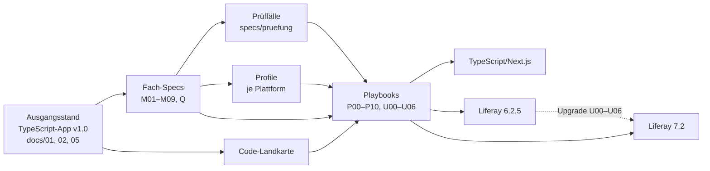
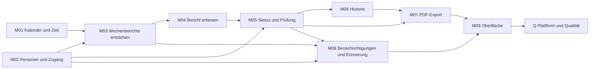

# Spec-Architektur Berichtsheft-App

Stand: 12.10.2026 · Status: **Entwurf zur Freigabe** · @Chris

Änderungen gegenüber der ersten Fassung vom 12.10.2026: Es gibt keinen VPS. Das Repository liegt in der Organisation
`Schoenechristopher` und wird öffentlich; schwere Jobs laufen auf den Standard-Runnern von GitHub (siehe
`docs/ci-richtlinie.md`). Betroffen sind die Abschnitte Etappen, Risiken und Offene Punkte. Die eingebetteten Grafiken
sind als Mermaid-Diagramme nachgebaut.

## Ziel und Geltungsbereich

Die Berichtsheft-App wird nach ihrer Abnahme (Release `v1.0`) so durch Specs, Unterspecs und Playbooks beschrieben, dass
eine Claude-Code-Steuerungsinstanz zwei Arten von Aufgaben erledigen kann: die gesamte App voll funktionsfähig auf einer
von drei Plattformen bauen und eine laufende Liferay-Instanz von 6.2.5 auf 7.2 migrieren. Die Steuerungsinstanz liest
Specs und Playbooks, teilt die Arbeit in Arbeitspakete und lässt jedes Paket von einer oder mehreren
Claude-Code-Entwicklersitzungen umsetzen.

- **Plattformen:** TypeScript/Next.js (heutige Referenz), Liferay Portal 6.2.5 CE (GA6), Liferay Portal 7.2 CE.
- **Upgrade:** eine befüllte 6.2.5-Instanz auf 7.2, ohne Datenverlust.
- **Zwei Wege je Modul:** Weg A baut aus dem Quellcode, Weg B aus der Fach-Spec. Jedes Playbook empfiehlt einen Weg und
  begründet ihn.
- **Fertig-Kriterium:** Eine Plattform ist fertig, wenn alle neutralen Prüffälle auf ihr grün sind. Das Upgrade ist
  fertig, wenn zusätzlich die Upgrade-Prüffälle grün sind.
- **Nachweis:** Je Plattform und für das Upgrade ein Blindtest. Eine frische Steuerungsinstanz bekommt nur das
  Repository und einen Satz wie „Baue die App auf Liferay 6.2.5 nach den Playbooks“. Bestanden ist er, wenn alle
  Prüffälle grün sind und keine Rückfrage nötig war.
- **Nicht im Umfang:** Liferay 7.4 (später über die Vorlage für neue Plattformen), Datenübernahme aus der
  TypeScript-App nach Liferay (optionales Playbook), Produktivbetrieb auf Liferay 6.2 oder 7.2.
- **Ablage:** alles im Repository `Schoenechristopher/berichtsheft-app`. `docs/01`, `docs/02` und `docs/05` bleiben als
  Referenz erhalten, maßgeblich werden die Fach-Specs ab Etappe G3.

## Aufbau

Fünf Ebenen bauen aufeinander auf. Die Fach-Specs sagen, was gilt. Die Code-Landkarte zeigt, wo es heute im Quellcode
steht. Die Prüffälle legen fest, woran man es erkennt. Die Profile beschreiben, wie eine Plattform es umsetzt. Die
Playbooks geben die Reihenfolge vor, in der eine Sitzung baut.



Alle drei Umsetzungen entstehen aus denselben Fach-Specs und Playbooks; das Upgrade führt eine laufende 6.2.5-Instanz
auf den Stand von 7.2.

```
berichtsheft-app/
├── src/, prisma/, e2e/, tests/        TypeScript-App (Referenz-Umsetzung, bleibt im Wurzelverzeichnis)
├── docs/                             01–06 als Referenz, ci-richtlinie
├── specs/
│   ├── 00-uebersicht.md              Ziel, Modulliste, Abhängigkeitsgraph, Begriffe, Lesereihenfolge
│   ├── M01-kalender-und-zeit.md … M09-oberflaeche.md
│   ├── Q-plattform-und-qualitaet.md
│   ├── code-landkarte.md
│   └── pruefung/
│       ├── format.md                 Aufbau der Prüffälle, Regeln für Adapter
│       ├── testdaten.json            Anna, Bernd, Clara, Dora, Emil
│       ├── M01.json … M09.json, Q.json
│       ├── szenarien.json            die drei Beispielszenarien als Abläufe
│       └── upgrade/                  Datenbestand vor dem Upgrade, erwarteter Zustand danach
├── profile/
│   ├── typescript-nextjs.md
│   ├── liferay-625.md
│   └── liferay-72.md
├── playbooks/
│   ├── 00-steuerung.md       Leitfaden für die Steuerungsinstanz
│   ├── vorlage-arbeitspaket.md   Auftrag an eine Entwicklersitzung
│   ├── typescript/    P00–P10
│   ├── liferay-625/   P00–P10
│   ├── liferay-72/    P00–P10
│   ├── upgrade-625-auf-72/   U00–U06
│   ├── vorlage-neue-plattform.md
│   └── optional-datenuebernahme.md
├── liferay-625/                      vollständige Umsetzung (Plugins SDK)
└── liferay-72/                       vollständige Umsetzung (Liferay Workspace, OSGi)
```

- **Rückverfolgbar:** Jede AK-ID (AK-101 … AK-1102, UI-AK-01 … UI-AK-20) gehört genau einem Modul und hat mindestens
  einen Prüffall. `npm run ak:abdeckung` prüft beides.
- **Änderungen:** Eine fachliche Änderung beginnt immer in der Fach-Spec und den Prüffällen. Danach werden die
  Umsetzungen nachgezogen. Ein Profil oder Playbook ändert nie eine Regel.

## Modulschnitt

Die App wird in neun Fachmodule und ein Querschnittsmodul geteilt. Der Schnitt folgt den Kapiteln der Spezifikation und
dem vorhandenen Code. Gebaut wird in der Reihenfolge M01 bis M09, weil jedes Modul nur auf früheren aufsetzt.

| Modul | Inhalt | AK-IDs | Code heute | Hängt ab von | Empfohlener Weg |
| --- | --- | --- | --- | --- | --- |
| M01 Kalender und Zeit | Uhr-Modul, ISO-Wochen in Europe/Berlin, Bundesländer, Feiertage | AK-404, Teile von AK-301 bis 304 | `src/domain/clock`, `weeks`, `holidays`, `federal-states` | – | A Quellcode |
| M02 Personen und Zugang | Rollen, Anmeldung, Zuordnung und Vertretung, Deaktivieren, Nutzerverwaltung | AK-101 ff., AK-201 ff. | `src/domain/people`, `access`; `src/lib/auth`, `src/lib/people` | – | B Spec (Liferay-Konten und -Rollen) |
| M03 Wochenberichte entstehen | Automatische Wochen ab Ausbildungsbeginn, außerhalb der Ausbildung, Definition „offen“ | AK-301 bis 306 | `src/domain/report-generation` | M01, M02 | A Quellcode |
| M04 Bericht erfassen | Tagesarten, Tätigkeiten, Längengrenze, Speichern, Bearbeitungsrechte | AK-401 bis 408 | `src/domain/report-days`, `src/lib/reports` | M03 | A für Regeln, B für Formular |
| M05 Status und Prüfung | Statusmodell, Pflichtfelder, Einreichen, Zurückziehen, Freigeben, Ablehnen, Rücknahme, Gleichzeitigkeit | AK-501 bis 508, 601 bis 607, 701 bis 704 | `src/domain/report-status`, `report-submission`, `report-access`; `src/lib/report-transitions` | M02, M04 | A, Transaktion und Sperre nach Profil |
| M06 Historie | Statuswechsel und Kommentare je Runde, unveränderlich | AK-801 bis 803 | `src/domain/report-history`, Datenbank-Trigger | M05 | A für Logik, B für Unveränderlichkeit |
| M07 PDF-Export | Einzel- und Sammel-PDF, Freigabevermerk, Kennzeichnung, Umlaute | AK-901 bis 907 | `src/domain/report-pdf`, `src/pdf/` | M05, M06 | A für Inhalt, Profil für Rendering |
| M08 Benachrichtigungen und Erinnerung | Kanäle je Person, Outbox, genau einmal senden, Montags-Erinnerung, Info an Ausbilder | AK-1001 bis 1025 | `src/domain/notifications`; `src/lib/notifications`; `src/worker/` | M02, M03, M05 | A für Regeln, B für Versand und Zeitplan |
| M09 Oberfläche | Tokens, Komponenten, Seiten, Dunkelmodus, Barrierefreiheit | UI-AK-01 bis 20 | `src/app/`, `src/components/` | alle | B Spec |
| Q Plattform und Qualität | Browser, 375 px, Testdaten, Beispielszenarien | AK-1101, 1102 | `e2e/` | alle | B Spec |

Die genaue Zuordnung jeder einzelnen AK-ID entsteht in Etappe G1 und G2. Eine ID, die zwei Module berührt, gehört dem
Modul, das die Regel besitzt; das andere verweist darauf.



M01 und M02 haben keine Abhängigkeiten und werden zuerst gebaut. M02 versorgt M03, M05 und M08; M07 nutzt neben M06 auch
M05. M09 und Q hängen von allen Modulen ab; im Diagramm stehen dafür nur die letzten Vorgänger.

## Vorlage Fach-Spec

Jede Fach-Spec (M01 bis M09, Q) hat dieselben zehn Abschnitte. Sie nennt keine Technik: keine Bibliothek, keine
Tabelle, keine Programmiersprache.

1. **Zweck und Abgrenzung:** was das Modul tut und was ausdrücklich nicht.
2. **Begriffe:** z. B. „offen“, „Prüfrunde“, „außerhalb der Ausbildung“, mit Verweis auf die zentrale Begriffsliste in
   `00-uebersicht.md`.
3. **Regeln:** nummeriert und einzeln überprüfbar, z. B. `M05-R03` „Ablehnen nur mit nicht leerem Gesamtkommentar“.
4. **Akzeptanzkriterien:** die AK-IDs mit ihrem Text aus `docs/01`, je ID die Regeln und Prüffall-IDs, die sie belegen.
5. **Logisches Datenmodell:** Entitäten, Felder, Pflicht, Wertebereiche, Eindeutigkeit, Beziehungen.
6. **Schnittstellen:** Angeboten werden neutrale Signaturen, z. B.
   `pruefeUebergang(status, aktion, rolle, bericht) → erlaubt | Fehler`. Genutzt wird, was andere Module anbieten.
7. **Ereignisse:** was das Modul auslöst, z. B. „Bericht eingereicht“ für M08, mit Inhalt.
8. **Anforderungen an die Plattform:** ohne Technikvorgabe, z. B. „Statuswechsel, Historie und Benachrichtigung in einer
   Transaktion“, „Historie technisch unveränderlich“, „Uhr für Tests einstellbar“.
9. **Bestätigte Auslegungen:** aus den Etappen 1 bis 8 übernommen, mit Datum.
10. **Offene Punkte.**

`00-uebersicht.md` enthält zusätzlich die Begriffsliste, den Abhängigkeitsgraph, die Rollen (Azubi, Ausbilder mit
Admin-Funktionen) und die Lesereihenfolge.

## Code-Landkarte

Die Code-Landkarte (`specs/code-landkarte.md`) ist die Unterspec für Weg A. Sie sagt einer Sitzung, welche Dateien ein
Modul umsetzen, in welcher Reihenfolge sie zu lesen sind und was sich 1:1 übertragen lässt.

Je Modul eine Tabelle, Beispiel M05 und M06:

| Datei / Funktion | Rolle | Regeln / AK | Plattformgebunden | Übertragung |
| --- | --- | --- | --- | --- |
| `src/domain/report-status.ts` → `transition()` | Statusmodell als reine Funktion | M05-R01 bis R08; AK-507, 607, 704 | nein | 1:1 übersetzen |
| `src/domain/report-submission.ts` | Pflichtfelder vor dem Einreichen | AK-501 bis 505 | nein | 1:1 übersetzen |
| `src/lib/report-transitions.ts` | Transaktion, Versionsprüfung, Einhängepunkt Benachrichtigung | AK-508, 1001 | ja (Prisma, PostgreSQL) | nach Profil neu bauen |
| `prisma/schema.prisma` → `StatusChange` mit Trigger | Historie unveränderlich | AK-802 | ja (Datenbank-Trigger) | nach Profil neu bauen |

Zusätzlich je Modul:

- **Einstieg:** welche Datei zuerst gelesen wird und warum.
- **Belege:** welche bestehenden Tests das Verhalten zeigen (Vitest, Playwright).
- **Fallen:** z. B. „jetzt“ nur aus dem Uhr-Modul, Datenbankverbindung fest in UTC, Feiertage beim Anlegen vorbelegt und
  später nicht neu berechnet.
- **Ersetzt durch Bordmittel:** was auf Liferay nicht übersetzt, sondern durch Liferay-Funktionen ersetzt wird
  (Anmeldung, Rollen, Benachrichtigungen in der App, Zeitplan).

Die Landkarte wird bei jeder Änderung am TypeScript-Code mitgepflegt. Ein Prüfskript meldet Dateien unter `src/domain/`
und `src/lib/`, die in der Landkarte fehlen.

## Neutrale Prüffälle

Die Prüffälle sind der gemeinsame Maßstab aller Plattformen. Sie liegen als JSON unter `specs/pruefung/`, jede Plattform
führt sie über einen eigenen Adapter aus. Jede Prüffall-ID beginnt mit der AK-ID, z. B. `AK-503-01`.

| Ebene | Prüft | Ausgeführt als |
| --- | --- | --- |
| Fachlogik | eine Schnittstelle aus der Fach-Spec: Eingabe → erwartetes Ergebnis | Unit-Test gegen die Fachlogik der Plattform |
| Ablauf | Schritte von Personen mit fachlichen Aktionen (einreichen, freigeben …) und das Ergebnis | Browser-Test gegen die laufende App; der Adapter übersetzt Aktionen in Klicks |
| Daten | Invarianten im Datenbestand, z. B. „Historie lässt sich weder ändern noch löschen“ | Test gegen die Datenhaltung der Plattform |
| Upgrade | Datenbestand vor dem Upgrade und erwarteter Zustand danach | Vergleich nach U06 |

**Fachlogik, Beispiel:**

```json
{
  "id": "AK-404-02",
  "modul": "M01",
  "ebene": "fachlogik",
  "schnittstelle": "istFeiertag",
  "eingabe": { "bundesland": "NI", "datum": "2027-05-27" },
  "erwartet": { "feiertag": false }
}
```

**Ablauf, Beispiel:**

```json
{
  "id": "AK-503-01",
  "modul": "M05",
  "ebene": "ablauf",
  "uhr": "2026-10-06T09:00:00+02:00",
  "schritte": [
    { "als": "anna", "aktion": "tag_erfassen", "woche": "2026-W40", "tag": "Mo", "tagesart": "Betrieb", "text": "" },
    { "als": "anna", "aktion": "einreichen", "woche": "2026-W40" }
  ],
  "erwartet": { "fehler": "taetigkeiten_fehlen", "tage": ["Mo"], "status": "Entwurf" }
}
```

**Regeln:**

- **Feste Begriffe:** Aktionen, Fehlercodes und Status sind in `format.md` abschließend aufgezählt. Meldungstexte prüft
  nur der Ablauf, und nur auf ihren Kern.
- **Uhr:** Jeder Fall nennt seine Uhrzeit; jede Plattform muss die Uhr für Tests stellen können.
- **Testdaten:** gemeinsam in `testdaten.json` (Anna, Bernd, Clara, Dora, Emil); jede Plattform lädt sie über ihren Seed.
- **Adapter:** TypeScript unter `tests/pruefung/`, Liferay je Umsetzung unter `…/pruefung/`. Ein Adapter darf Aktionen
  übersetzen, aber kein Ergebnis umdeuten.
- **Plattformgrenzen:** Wo eine Plattform eine Regel bewusst anders erfüllt (z. B. Anmeldung mit Liferay-Konten), steht
  das im Profil, und der Fall ist dort als „abweichend, begründet“ markiert. Ein stilles Überspringen gibt es nicht.
- **Abdeckung:** `npm run ak:abdeckung` meldet jede AK-ID ohne Prüffall und jeden Prüffall ohne AK-ID.

## Plattform-Profile

Ein Profil übersetzt die Anforderungen der Fach-Specs in die Mittel einer Plattform. Auf Liferay werden Bordmittel
genutzt: eigene Konten, Rollen, Benachrichtigungen, Theme und Zeitplan. Die Oberfläche folgt der UI-Spezifikation
sinngemäß.

**Abschnitte jedes Profils:**

1. Laufzeit und Versionen (Sprache, Server, Datenbank, Suchdienst)
2. Projektstruktur und Build
3. Abbildung der Bausteine (Tabelle unten)
4. Tests und Prüf-Adapter
5. Lokaler Start, Cloud-Sitzung und CI
6. Bewusste Abweichungen von Fach-Specs, mit Begründung
7. Fallstricke und Grenzen

**Abbildung der Bausteine (Entwurf, wird in P00 je Plattform bestätigt):**

| Baustein | TypeScript/Next.js | Liferay 6.2.5 CE | Liferay 7.2 CE |
| --- | --- | --- | --- |
| Laufzeit | Node, Next.js, PostgreSQL | Java 7/8, Tomcat 7, Plugins SDK | Java 8/11, Tomcat 9, Liferay Workspace (Gradle), OSGi |
| Anmeldung | Auth.js mit OIDC (Keycloak, später Entra ID) | Liferay-eigene Konten | Liferay-eigene Konten; OIDC optional |
| Rollen und Besitz | eigene Prüfung in jeder Serveraktion | Liferay-Rollen plus eigene Prüfung im Service | wie 6.2.5 |
| Persistenz | Prisma | Service Builder | Service Builder |
| Transaktion und Gleichzeitigkeit | bedingtes Update mit Version | Service-Transaktion, Versionsspalte von Hand | Service-Transaktion, Versionsspalte |
| Historie unveränderlich | Datenbank-Trigger | ModelListener sperrt Ändern und Löschen | wie 6.2.5 |
| Uhr | `src/domain/clock.ts` | eigener Uhr-Service, für Tests stellbar | eigener OSGi-Uhr-Service |
| Hintergrundjobs | pg-boss Worker | Scheduler-Eintrag im Portlet | Scheduler mit MessageListener |
| Benachrichtigung in der App | eigene Tabelle und Glocke | Liferay-Benachrichtigungen (UserNotification) | wie 6.2.5 |
| E-Mail | Nodemailer → Mailpit | Liferay-Mailservice → Mailpit | wie 6.2.5 |
| Teams | Adapter mit Demo-Postfach | Adapter mit Demo-Postfach | Adapter mit Demo-Postfach |
| PDF | @react-pdf/renderer, Noto Sans | Java-PDF-Bibliothek, Noto Sans eingebettet | wie 6.2.5 |
| Oberfläche | Next.js-Seiten, Tailwind | Portlets, AlloyUI/Bootstrap 2, eigenes Theme | Portlets, Clay/Bootstrap 4, eigenes Theme |
| Dunkelmodus | Tokens, Umschalter, System | nur über Theme, Umfang wird in P00 geklärt | Theme mit CSS-Variablen, Umschalter |
| Prüf-Adapter | Vitest und Playwright | JUnit und Playwright | JUnit/Integrationstests und Playwright |

**Bewusste Abweichung, bereits entschieden:** Auf Liferay melden sich die Testpersonen mit Liferay-eigenen Konten an
statt über ein Firmenkonto (AK zur Anmeldung). Die Prüffälle dazu sind auf Liferay als „abweichend, begründet“
markiert.

## Playbooks

Ein Playbook ist eine Schritt-für-Schritt-Anleitung in Markdown, die eine Entwicklersitzung abarbeitet und ein
Entwickler nachlesen kann. Auf den Satz „Baue die App auf Liferay 6.2.5“ hin liest die Steuerungsinstanz
`playbooks/00-steuerung.md` und vergibt die Reihe der Plattform von P00 bis P10 als Arbeitspakete.

### Steuerung und Arbeitspakete

Es gibt immer genau eine Steuerungsinstanz je Vorhaben; sie entwickelt selbst nicht. Die Entwicklung geschieht in
eigenen Claude-Code-Sitzungen mit frischem Kontext, wie bei den Etappen 1 bis 8.

| Rolle | Aufgaben |
| --- | --- |
| Steuerungsinstanz | liest Fach-Specs, Profil und Playbooks; schneidet Arbeitspakete; schreibt je Paket einen Auftrag nach `vorlage-arbeitspaket.md`; startet die Entwicklersitzungen; prüft PR, CI und Prüffälle; führt die Fortschrittsdatei; gibt Rückfragen gesammelt an Chris weiter |
| Entwicklersitzung | setzt genau ein Arbeitspaket nach Playbook um: Branch, Tests, Draft-PR mit AK-Tabelle und „Bitte bestätigen“; meldet Ergebnis und offene Punkte an die Steuerung |
| Chris | gibt Auslegungen frei und mergt alles, was nach `docs/07-spec-automatisches-mergen.md` nicht automatisch gemergt werden darf; im Blindtest übernimmt die Steuerungsinstanz das Mergen in Wegwerf-Branches |

- **Arbeitspaket:** in der Regel ein Playbook (P00 bis P10, U00 bis U06). Große Playbooks teilt die Steuerung nach den
  Regeln in `00-steuerung.md`.
- **Reihenfolge und Parallelität:** folgt dem Abhängigkeitsgraph. Pakete ohne gegenseitige Abhängigkeit laufen
  parallel, z. B. M01 und M02 oder M06 und M08.
- **Auftrag an eine Entwicklersitzung:** Ziel und Fertig-Kriterium, Playbook, Eingaben, Branch, empfohlener Weg, Regeln
  zur CI (`docs/ci-richtlinie.md`), erwartete Rückmeldung.
- **Abnahme eines Pakets:** Die Steuerung nimmt ein Paket erst an, wenn seine Prüffälle grün sind und die vorher
  fertigen Pakete grün bleiben.

**Vorlage je Playbook:**

1. **Ziel und Fertig-Kriterium:** z. B. „Alle Prüffälle von M05 grün auf Liferay 7.2.“
2. **Voraussetzungen:** fertige Playbooks, nötige Werkzeuge, Abschnitte des Profils.
3. **Eingaben:** Fach-Spec, Abschnitt der Code-Landkarte, Prüffälle.
4. **Weg A, aus dem Quellcode:** Dateien in Lesereihenfolge; was 1:1 übersetzt und was nach Profil ersetzt wird.
5. **Weg B, aus der Spec:** Regeln und Schnittstellen in Bau-Reihenfolge.
6. **Empfehlung:** welcher Weg für dieses Modul und warum. Auf ausdrücklichen Auftrag geht die Sitzung den anderen Weg.
7. **Schritte:** nummeriert, jeder mit einem kurzen Prüfschritt.
8. **Prüfung:** Befehle und erwartete Ausgabe.
9. **Abschluss:** Commit, Eintrag in der Fortschrittsdatei, Notizen für den PR (AK-Tabelle, Abweichungen, „Bitte
   bestätigen“).
10. **Typische Fehler** und was dann zu tun ist.

**Reihe je Plattform (typescript, liferay-625, liferay-72):**

| Nr. | Inhalt |
| --- | --- |
| P00 | Grundgerüst: Umgebung prüfen und aufsetzen, leere App startet, Prüf-Adapter läuft, Testdaten geladen; auf Liferay zusätzlich Speicherbedarf und Laufzeit auf dem Standard-Runner messen |
| P01–P09 | je ein Modul M01 bis M09 in Bau-Reihenfolge |
| P10 | Abnahme: Q, Beispielszenarien, alle Prüffälle grün, Demo-Anleitung für diese Plattform |

**Upgrade 6.2.5 → 7.2 (`upgrade-625-auf-72/`):**

| Nr. | Inhalt |
| --- | --- |
| U00 | Bestandsaufnahme: Version, Plugins, eigene Tabellen, Datenbank; Upgrade-Pfad nach Liferay-Doku prüfen |
| U01 | Sicherung von Datenbank und Dokumentenablage, Rücksprungweg festlegen und testen |
| U02 | Code-Upgrade: Portlets, Hooks und Service Builder aus dem Plugins SDK in Workspace-Module überführen; Ziel ist der Stand von `liferay-72/` |
| U03 | Daten-Upgrade: Liferay-Upgrade-Werkzeug für Portal-Tabellen, eigene Upgrade-Schritte für die App-Tabellen |
| U04 | Konfiguration: Konten, Rollen, Mail, Zeitplan, Theme |
| U05 | Suchindex neu aufbauen |
| U06 | Abnahme: Upgrade-Prüffälle (Berichte, Statuswechsel, Kommentare unverändert) und alle Prüffälle auf 7.2 grün |

**Fortschrittsdatei:** Jede Umsetzung führt `FORTSCHRITT.md` mit Playbook, Stand, Datum, Commit und offenen Punkten.
Nach jedem Playbook gibt es einen Commit. Die Steuerungsinstanz führt die Datei: Sie sieht jederzeit, welche Pakete
fertig sind, und vergibt das nächste. Bricht eine Entwicklersitzung ab, startet sie für das offene Paket eine neue.

**Weitere Dateien:**

- **`vorlage-neue-plattform.md`:** zuerst ein Profil nach der Profil-Vorlage anlegen, dann die Reihe P00 bis P10 aus der
  Vorlage ableiten. Gedacht für z. B. Java/Spring, .NET oder Liferay 7.4.
- **`optional-datenuebernahme.md`:** Übernahme von Personen, Berichten und Historie aus der TypeScript-App in eine
  Liferay-Umsetzung.

## Etappen

Die Arbeit beginnt nach der Abnahme von `v1.0`. Jede Etappe ist eine eigene Entwickler-Sitzung mit Branch, Draft-PR und
Freigabe durch Chris, wie bei Etappe 1 bis 8.

| Etappe | Inhalt | Ergebnis | Voraussetzung |
| --- | --- | --- | --- |
| G1 Rahmen und Pilotmodul | Ordner, Vorlagen, `format.md`, Prüf-Runner für TypeScript, M01 komplett (Fach-Spec, Landkarte, Prüffälle) | Format erprobt und freigegeben | `v1.0` abgenommen |
| G2 Zerlegung Fachlogik | M02 bis M08: Fach-Specs, Landkarte, Prüffälle; TypeScript besteht alle | Fachlogik vollständig neutral beschrieben | G1 |
| G3 Oberfläche und Abläufe | M09, Q, Ablauf-Prüffälle, Szenarien, Abdeckungsprüfung | Fach-Specs werden maßgeblich, `CLAUDE.md` angepasst | G2 |
| G4 Profile und Playbooks | Profile für TypeScript, 6.2.5 und 7.2; alle Reihen P00 bis P10, U00 bis U06, Vorlage, Datenübernahme | Anleitung vollständig, noch unerprobt | G3 |
| A Automatisches Mergen | Workflow nach Änderungsklassen, Merge-Kriterien als Check, Schattenbetrieb (`docs/07-spec-automatisches-mergen.md`) | Arbeitspakete der Liferay-Etappen werden ohne Klick von Chris gemergt, wenn sie die Kriterien erfüllen | parallel zu G1–G4, fertig vor L62 |
| L62 Liferay 6.2.5 | Komplette App nach Playbooks in `liferay-625/` | alle Prüffälle grün auf 6.2.5 | G4, A |
| L72 Liferay 7.2 | Komplette App nach Playbooks in `liferay-72/` | alle Prüffälle grün auf 7.2 | G4, A |
| U Upgrade | Befüllte 6.2.5-Instanz nach U00 bis U06 auf 7.2 | Upgrade-Prüffälle und alle Prüffälle grün | L62, L72 |
| B Blindtests | Je eine frische Steuerungsinstanz für TypeScript, 6.2.5, 7.2 und Upgrade, nur mit einem Satz als Auftrag; sie startet ihre Entwicklersitzungen selbst; Ergebnis in Wegwerf-Branches | Nachweis „ein Satz an die Steuerung reicht“ | U |
| G5 Nachschärfen | Erkenntnisse aus L62, L72, U und B in Specs, Profile und Playbooks | geprüfte, wiederholbare Anleitung | B |

- **Parallel möglich:** L62 und L72 können gleichzeitig in zwei Sitzungen laufen, sobald die Profile (G4) für beide
  dieselben App-Tabellen festlegen. Sonst muss U03 Unterschiede zwischen den beiden Umsetzungen ausgleichen, die gar
  nicht fachlich begründet sind.
- **Aufteilung:** L62 und L72 werden voraussichtlich in mehrere PRs geteilt (z. B. P00 bis P04, P05 bis P08, P09 bis
  P10), damit Reviews überschaubar bleiben.
- **CI:** Das Repository ist öffentlich, die Standard-Runner von GitHub kosten dafür keine Minuten. G1 bis G4 brauchen
  nur die schnelle Prüfung. Ab L62 laufen Liferay-Jobs nur bei Änderungen unter `liferay-625/` bzw. `liferay-72/` und
  erst, wenn der PR auf „bereit“ steht; der Upgrade-Test startet nur von Hand. Die Regeln stehen in
  `docs/ci-richtlinie.md`, Abschnitt 7 wird mit L62 ergänzt.
- **Entwickeln vor allem in der Cloud-Sitzung:** Container lassen sich dort nicht starten, Liferay-Bundles nativ
  voraussichtlich schon (wie Keycloak). P00 klärt das je Plattform. Dann laufen die meisten Testläufe in der Sitzung,
  und GitHub Actions prüft vor dem Merge.

## Risiken und zu prüfende Punkte

Die folgenden Punkte stammen aus Erfahrungswissen und sind noch nicht gegen die Liferay-Dokumentation geprüft. P00 und
U00 klären sie zuerst, bevor gebaut wird.

| Punkt | Auswirkung | Gegenmaßnahme |
| --- | --- | --- |
| Liferay 6.2 und 7.2 ohne Herstellersupport | keine Sicherheitsupdates | nur Demo und Übung; kein Produktivbetrieb ohne gesonderte Entscheidung |
| Laufzeit von 6.2.5 (Java 7/8, Tomcat 7, Bundle-Bezug, Docker-Image) | Aufbau in Cloud-Sitzung und CI evtl. aufwendig | P00 prüft Bezugsquelle und Java-Version und baut bei Bedarf ein eigenes Image |
| Suchdienst von 7.2 (Elasticsearch) | mehr Speicher, längere Starts | eingebetteter Modus für Tests, falls zulässig; sonst eigener Container |
| Speicher und Laufzeit auf dem Standard-Runner (öffentliches Repository: 4 Kerne, 16 GB RAM, 14 GB SSD) | 7.2 mit Datenbank und Elasticsearch könnte eng werden; Liferay-Läufe dauern geschätzt 20 bis 40 Minuten, der Upgrade-Lauf 45 bis 90 Minuten | P00 misst Speicher und Laufzeit; Liferay-Bundles aus dem Actions-Cache; Liferay-Jobs nur bei Pfadänderungen und bereiten PRs; Upgrade-Test nur von Hand |
| Öffentliches Repository | Logs, Artefakte und PRs sind für alle sichtbar; fremde PRs können Workflows starten | nur Testdaten und Demo-Zugänge; Workflows aus Forks nur nach Freigabe; keine selbst betriebenen Runner (`docs/ci-richtlinie.md` Abschnitt 4) |
| Upgrade-Pfad 6.2 → 7.2 | Zwischenschritte oder Datenbankversionen nötig | U00 prüft den offiziellen Pfad, bevor U02 beginnt |
| Oberfläche auf 6.2 (AlloyUI, Bootstrap 2) | UI-Spezifikation nur sinngemäß, Dunkelmodus begrenzt | Abweichungen im Profil begründen, UI-AK auf 6.2 einzeln bewerten |
| Umfang einer kompletten Liferay-App | Abbruch oder Kontextverlust | Steuerungsinstanz verteilt auf Entwicklersitzungen je Playbook; Fortschrittsdatei, Commit je Paket, Neustart eines abgebrochenen Pakets |
| Abweichende Plattformmittel verändern Verhalten unbemerkt | Migration nur scheinbar gleichwertig | gleiche Prüffälle überall, Abweichungen nur begründet und markiert |

### Offene Punkte

- [ ] Bezugsquelle für Liferay 6.2.5 CE GA6 und passende Java-Version festlegen (P00).
- [ ] Ob Liferay-Bundles, Java 8/11 und die Bezugsquellen in der Cloud-Sitzung erreichbar sind (P00).
- [ ] Ob OpenID Connect auf 7.2 CE optional mitgeliefert wird (Profil 7.2).
- [ ] Umfang des Dunkelmodus auf 6.2.5 (Profil 6.2.5).
- [ ] AK-301 bis 304 stehen bei M01 („Teile von“) und bei M03. Wem gehören sie nach der Regel „gehört dem Modul, das die
      Regel besitzt“? (G1)
- [ ] Der Blindtest verlangt „keine Rückfrage“, `CLAUDE.md` verlangt „nachfragen, nicht raten“. Wie verhält sich die
      Steuerungsinstanz im Blindtest bei einer echten Lücke: anhalten und als „nicht bestanden“ werten oder die Lücke
      vermerken und mit einer Annahme weiterbauen? (G4, `00-steuerung.md`)
- [ ] Wo baut der TypeScript-Blindtest: in einem leeren Wegwerf-Branch oder in einem Unterordner? Das Wurzelverzeichnis
      ist von der Referenz belegt. (G4)
- [ ] Wer schreibt `FORTSCHRITT.md`: nur die Steuerung, oder auch die Entwicklersitzung im Abschluss-Schritt? Bei
      parallelen Paketen drohen sonst Merge-Konflikte. (G4)
- [ ] Zählt ein Prüffall „abweichend, begründet“ für das Fertig-Kriterium „alle Prüffälle grün“? (G1, `format.md`)
- [ ] Gleiche App-Tabellen, Spalten und Versionsspalten in `liferay-625/` und `liferay-72/`, damit U03 nur die
      Liferay-eigenen Unterschiede ausgleicht. (G4, beide Profile)
