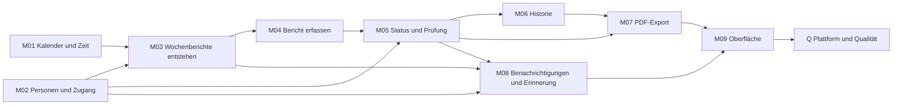

# Übersicht der Fach-Specs

Stand: 12.10.2026 (Etappe G1) · Status: **Entwurf zur Freigabe** · @Chris

## Ziel

Die Berichtsheft-App wird modulweise technikneutral beschrieben (`docs/06-spec-architektur.md`), damit eine
Steuerungsinstanz sie auf TypeScript/Next.js, Liferay 6.2.5 und Liferay 7.2 bauen kann. Je Modul gibt es eine Fach-Spec
(was gilt), einen Abschnitt in der Code-Landkarte (wo es heute im Quellcode steht) und neutrale Prüffälle (woran man es
erkennt). Eine Plattform ist fertig, wenn alle Prüffälle auf ihr grün sind.

`docs/01`, `docs/02` und `docs/05` bleiben Referenz; maßgeblich werden die Fach-Specs ab Etappe G3. Bis dahin gilt bei
einem Widerspruch `docs/01`.

## Module

Stand G1: beschrieben ist nur M01. Die AK-Zuordnung der übrigen Module ist vorläufig (`docs/06`, „Modulschnitt“) und
wird in G2 und G3 festgelegt.

| Modul | Fach-Spec | AK-IDs | Stand |
| --- | --- | --- | --- |
| M01 Kalender und Zeit | `M01-kalender-und-zeit.md` | AK-404, AK-1201 bis AK-1206 | beschrieben (G1) |
| M02 Personen und Zugang | – | AK-101 ff., AK-201 ff. | G2 |
| M03 Wochenberichte entstehen | `M03-wochenberichte-entstehen.md` | AK-301 bis AK-306 | beschrieben (G2) |
| M04 Bericht erfassen | `M04-bericht-erfassen.md` | AK-401 bis AK-408 (ohne AK-404) | beschrieben (G2) |
| M05 Status und Prüfung | – | AK-501 bis AK-508, AK-601 bis AK-607, AK-701 bis AK-704 | G2 |
| M06 Historie | – | AK-801 bis AK-803 | G2 |
| M07 PDF-Export | – | AK-901 bis AK-907 | G2 |
| M08 Benachrichtigungen und Erinnerung | – | AK-1001 bis AK-1025 | G2 |
| M09 Oberfläche | – | UI-AK-01 bis UI-AK-20 | G3 |
| Q Plattform und Qualität | – | AK-1101, AK-1102 | G3 |

## Abhängigkeiten

Gebaut wird in der Reihenfolge M01 bis M09, dann Q. M01 und M02 hängen von keinem Modul ab. M09 und Q hängen von allen
ab; im Diagramm stehen nur die letzten Vorgänger.

## Rollen

| Rolle | Aufgaben |
| --- | --- |
| Azubi | Wochenberichte schreiben, einreichen, zurückziehen, überarbeiten |
| Ausbilder (zugleich Admin) | Berichte prüfen, freigeben, ablehnen, Freigabe zurücknehmen; Personen, Rollen, Zuordnung und Bundesland verwalten |

Jeder Azubi hat genau einen zugeordneten Ausbilder; prüfen darf jeder Ausbilder (Vertretung).

## Begriffe

| Begriff | Bedeutung |
| --- | --- |
| Wochenbericht | Bericht eines Azubis für eine Kalenderwoche, Tage Mo–Fr; genau einer pro Azubi und Woche |
| Woche | ISO-Kalenderwoche (Montag bis Sonntag, KW 1 enthält den 4. Januar), siehe M01 |
| Kalendertag | Datum ohne Uhrzeit, bestimmt in der Zeitzone der Firma (Europe/Berlin), siehe M01 |
| Jetzt | der Zeitpunkt laut Uhr von M01; für Tests stellbar, im Produktivbetrieb nicht |
| Bundesland | eines der 16 Länder mit festem Kürzel; bestimmt die Feiertage, siehe M01 |
| Feiertag | landesweiter gesetzlicher Feiertag des eingestellten Bundeslands, siehe M01 |
| Offen | Status „Entwurf“ oder „Abgelehnt“ und Woche nicht ganz außerhalb der Ausbildung; zählt als nicht eingereicht, auch für die Erinnerung. Zentrale Definition: M03 (M03-R14) |
| Vorbelegt | Tag, den das System beim Anlegen als „Feiertag“ gesetzt hat; der Merker bleibt bei einem Bundeslandwechsel, siehe M03 |
| Außerhalb der Ausbildung | Tag vor Ausbildungsbeginn oder nach Ausbildungsende; ausgegraut, keine Pflicht |
| Zugeordneter Ausbilder | der Ausbilder, den der Admin dem Azubi fest zugewiesen hat |
| Vertretung | jeder andere Ausbilder; darf prüfen, wird aber nicht benachrichtigt |
| Kanal | Weg einer Benachrichtigung: E-Mail, Teams oder App |
| Prüffall | neutraler, maschinenlesbarer Test einer AK-ID, siehe `pruefung/format.md` |

Weitere Begriffe stehen in `docs/01-spezifikation.md`, „Begriffe und bestätigte Annahmen“.

## Lesereihenfolge

1. Diese Übersicht.
2. `pruefung/format.md`: Aufbau der Prüffälle, Datenformate, Fehlercodes, Regeln für Adapter.
3. Je Modul in Bau-Reihenfolge: Fach-Spec `Mxx-*.md`, dann `pruefung/Mxx.json`, für Weg A zusätzlich der Abschnitt in
   `code-landkarte.md`.
4. Für eine Plattform: ihr Profil unter `profile/` und die Playbooks unter `playbooks/` (ab G4).

Neue Fach-Specs entstehen aus `vorlage-fach-spec.md`. Testdaten für alle Plattformen stehen in
`pruefung/testdaten.json` (Anna, Bernd, Clara, Dora, Emil).
